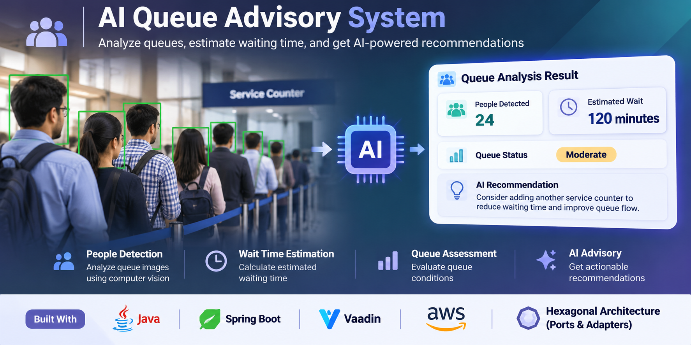
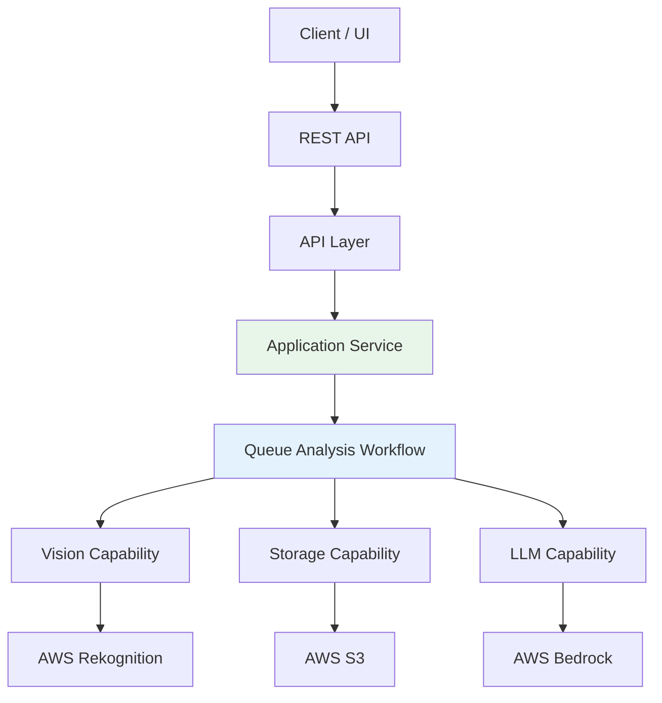
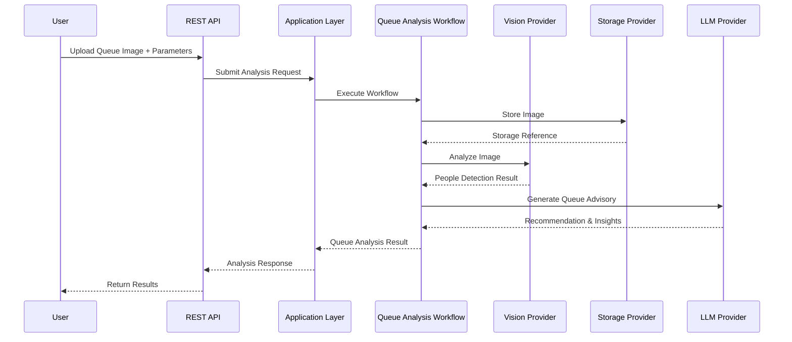

# AI Queue Advisory System

<p align="center">
  
</p>

<p align="center">
  <strong>AI-powered queue analysis and intelligent advisory using Cloud AI services.</strong>
</p>

<p align="center">
  A cloud-native application that analyzes queue images, estimates crowd size and waiting time, evaluates queue conditions, and generates actionable recommendations using AI.
</p>

---

## Overview

The **AI Queue Advisory System** is a cloud-based AI application designed to analyze queue conditions from images and provide intelligent insights and recommendations.

The application combines computer vision and Generative AI capabilities to estimate queue metrics and provide advisory information that can help users make informed decisions about queue management.

The project is being developed using **Java and Spring Boot**, following a **Hexagonal Architecture (Ports & Adapters)** approach to keep business logic independent of cloud providers and infrastructure implementations.

The architecture is designed to support multiple cloud platforms while maintaining a reusable application core.

## Key Features

- 🖼️ Queue image analysis
- 👥 People detection and crowd estimation
- ⏱️ Estimated waiting time calculation
- 📊 Queue condition assessment
- 🤖 AI-generated recommendations and insights
- ☁️ Cloud-based AI service integration
- 🔌 Capability-based architecture for AI integrations
- 🏗️ Hexagonal Architecture (Ports & Adapters)
- 🔄 REST API-based application interface
- 🌐 Multi-cloud extensibility
- 🧩 Modular and reusable architecture

---

## Architecture

The application follows **Hexagonal Architecture**, separating the domain and application logic from external infrastructure and cloud-specific implementations.



### Architectural Principles

- Domain logic remains independent of infrastructure.
- Application workflows orchestrate business capabilities.
- Cloud integrations are implemented through adapters.
- Capability interfaces abstract external AI services.
- Cloud-specific implementations can be replaced without modifying the core application.
- REST API acts as the application-facing interface.
- The architecture supports future multi-cloud implementations.

---

## Technology Stack

### Backend

| Technology | Purpose |
|---|---|
| Java | Primary programming language |
| Spring Boot | Application framework |
| Gradle | Build automation |
| Spring REST | API layer |
| Spring RestClient | HTTP client integration |

### Cloud & AI

| Technology | Purpose |
|---|---|
| AWS S3 | Image storage |
| AWS Rekognition | Image analysis and people detection |
| AWS Bedrock | Generative AI and recommendations |

### Frontend

| Technology | Purpose |
|---|---|
| Vaadin Flow | Java-based UI |
| Java | UI development |

### Architecture & Engineering

- Hexagonal Architecture
- Ports & Adapters
- Capability-based design
- REST API
- Dependency Injection
- Domain-driven design principles

### Infrastructure

- Terraform — planned
- Docker — planned
- CI/CD — planned

---

## AI Capabilities

The system is designed around independent AI capabilities rather than direct dependencies on specific cloud services.

### Vision Capability

Responsible for analyzing queue images and extracting information such as the number of people detected.

**Current implementation:** AWS Rekognition adapter.

### Storage Capability

Responsible for storing uploaded queue images and providing storage references.

**Current implementation:** AWS S3 adapter.

### LLM Capability

Responsible for generating contextual queue insights and recommendations based on analysis data.

**Current implementation:** AWS Bedrock adapter.

---

## Project Structure

```text
src/main/java/com/mihirjha/cloudai/queue/
│
├── api/
│   ├── controller/
│   ├── service/
│   ├── request/
│   ├── response/
│   └── exception/
│
├── application/
│   ├── service/
│   └── workflow/
│
├── domain/
│   ├── model/
│   ├── valueobject/
│   ├── enums/
│   └── exception/
│
├── ports/
│   ├── inbound/
│   └── outbound/
│
├── adapters/
│   ├── inbound/
│   │   └── rest/
│   │
│   └── outbound/
│       └── aws/
│           ├── bedrock/
│           ├── rekognition/
│           └── s3/
│
├── configuration/
├── prompts/
│
├── common/
│   ├── constants/
│   ├── mapper/
│   └── util/
│
└── ui/
    ├── layout/
    ├── view/
    ├── component/
    └── service/
```

---

## API

### Analyze Queue

Analyzes a queue image and returns queue metrics and AI-generated advisory.

**Endpoint**

```http
POST /api/v1/queue/analyze
```

**Content-Type**

```http
multipart/form-data
```

### Request Parameters

| Parameter | Description |
|---|---|
| `image` | Queue image file |
| `request` | Analysis configuration |

### Analysis Configuration

```json
{
  "minutesPerPerson": 5,
  "availableTimeMinutes": 60
}
```

### Expected Analysis Output

Depending on the analysis and configured AI capabilities, the response provides information such as:

- Estimated number of people
- Estimated waiting time
- Queue status
- AI-generated recommendation
- Analysis reasoning
- Image storage reference

---

## Workflow



---

## Getting Started

### Prerequisites

- Java 25
- Gradle Wrapper
- AWS account
- AWS credentials and permissions configured for the required services

### Clone the Repository

```bash
git clone https://github.com/<your-username>/ai-queue-advisory-system.git

cd ai-queue-advisory-system
```

### Build the Application

```bash
./gradlew clean build
```

On Windows:

```bash
gradlew.bat clean build
```

### Run the Application

```bash
./gradlew bootRun
```

On Windows:

```bash
gradlew.bat bootRun
```

---

## Configuration

Cloud provider configurations and credentials should be managed through environment variables or external configuration rather than hardcoded values.

Example configuration:

```yaml
spring:
  application:
    name: ai-queue-advisory-system
```

Configure the required AWS credentials and service settings according to the adapters and application configuration.

> Never commit AWS credentials, API keys, access tokens, or secrets to the repository.

---

## Development Roadmap

### Phase 1 — Solution Design
- [x] Solution architecture
- [x] Domain identification
- [x] Architecture decisions

### Phase 2 — Project Foundation
- [x] Spring Boot application foundation
- [x] Gradle configuration
- [x] Project structure

### Phase 3 — Domain Design
- [x] Domain models
- [x] Value objects
- [x] Domain enums
- [x] Domain validation
- [x] Domain exceptions

### Phase 4 — Capability Ports
- [x] Vision capability
- [x] Storage capability
- [x] LLM capability

### Phase 5 — AWS Adapters
- [x] AWS S3 integration
- [x] AWS Rekognition integration
- [x] AWS Bedrock integration

### Phase 6 — Application Layer
- [x] Application services
- [x] Queue analysis workflow
- [x] Prompt management
- [x] Workflow orchestration

### Phase 7 — REST API
- [x] API controllers
- [x] Request and response models
- [x] Request validation
- [x] Exception handling
- [x] API documentation

### Phase 8 — User Interface
- [x] Vaadin dependencies
- [x] UI layout foundation
- [x] Image upload component
- [x] Queue analysis form
- [x] Queue result component
- [ ] REST API client integration
- [ ] UI workflow integration
- [ ] Loading and error states
- [ ] UI styling and polish

### Phase 9 — Testing
- [ ] Unit testing
- [ ] Application layer testing
- [ ] Adapter testing
- [ ] API integration testing

### Phase 10 — Observability
- [ ] Logging enhancements
- [ ] Metrics
- [ ] Distributed tracing
- [ ] AI operation monitoring

### Phase 11 — CI/CD
- [ ] CI pipeline
- [ ] Build automation
- [ ] Quality checks
- [ ] Deployment pipeline

### Phase 12 — Infrastructure as Code
- [ ] Terraform infrastructure
- [ ] AWS resource provisioning
- [ ] Environment configuration

### Phase 13 — Multi-Cloud
- [ ] Azure adapters
- [ ] GCP adapters
- [ ] Provider configuration strategy
- [ ] Multi-cloud deployment strategy

---

## Multi-Cloud Vision

The application is designed to evolve beyond AWS by implementing cloud-specific adapters behind shared capability interfaces.

| Capability | AWS | Azure | GCP |
|---|---|---|---|
| Object Storage | S3 | Blob Storage | Cloud Storage |
| Vision | Rekognition | Azure AI Vision | Cloud Vision |
| Generative AI | Bedrock | Azure AI | Vertex AI |

The application core and domain logic should remain unchanged when switching infrastructure implementations.

---

## Engineering Goals

This project explores practical engineering approaches to building production-oriented AI applications:

- Cloud-agnostic application architecture
- Provider-independent domain logic
- AI capability abstraction
- Maintainable AI workflows
- Modular cloud integration
- Enterprise-ready API design
- Infrastructure automation
- Observability
- Multi-cloud extensibility

---


---

## Future Enhancements

- Local AI development profile
- Local vision model integration
- Ollama integration for LLM inference
- Local filesystem storage adapter
- Provider-based configuration
- AI model evaluation
- Queue trend analysis
- Historical queue analytics
- Multi-image analysis
- Real-time queue monitoring
- Cloud deployment automation
- Multi-cloud AI capabilities

---

## License

This project is currently under development.

A license will be added when the repository is ready for public distribution.

---

<p align="center">
  <strong>Building cloud-native AI applications with clean architecture and reusable AI capabilities.</strong>
</p>
